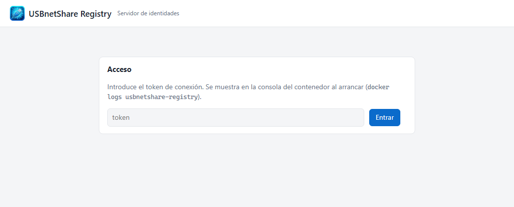
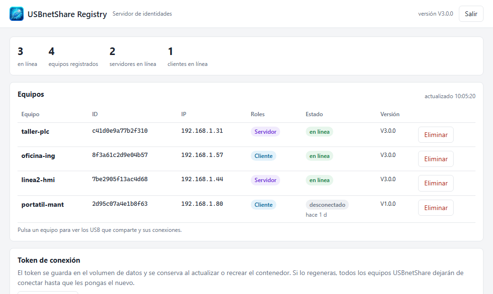
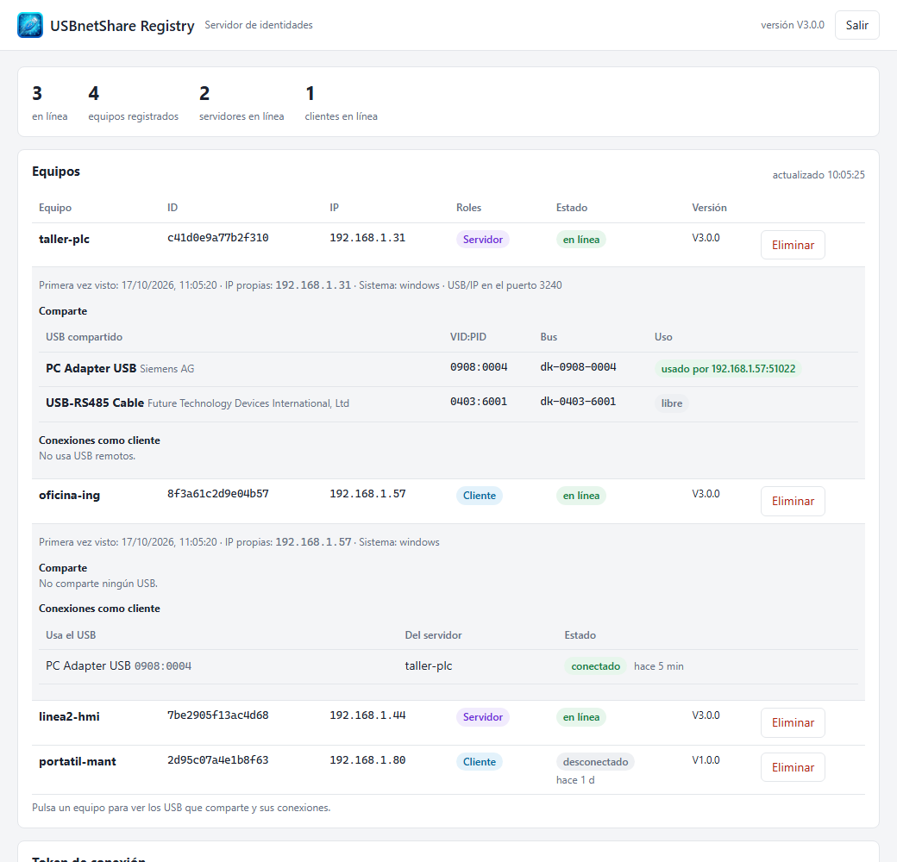

# Tutorial: el coordinador de USBnetShare (usbnetshare-registry en Docker)

El **coordinador** (en el código y la interfaz, «servidor de identidades» o **usbnetshare-registry**)
es un pequeño servicio en Docker que mantiene la lista de equipos USBnetShare de la red:


- Cada USBnetShare le envía un **latido** cada 15 s con su ID, IP, roles y los USB que comparte.
- Cuando un cliente quiere un USB, le pregunta **dónde está** el servidor por su ID, así que la
  conexión sobrevive a cambios de IP o de nombre del PC.
- Los USB **no pasan por el coordinador**: los datos van directamente de PC a PC (TCP 3240).
- Tiene una **interfaz web** para ver qué equipos hay, qué comparten y quién usa qué.

Se instala **una sola vez** por red. Este tutorial es para quien administra el servidor Docker.

---

## 1. Requisitos

- Un equipo con Docker (en los ejemplos, `<servidor-docker>`) y Portainer, o `docker compose`.
- Acceso al repositorio `http://<servidor-git>/<grupo>/USBNetShare.git`.
- Puerto **TCP 3250** abierto desde los PC con USBnetShare hacia el equipo Docker.

## 2. Desplegar con Portainer (recomendado)

1. En Portainer: **Stacks → Add stack**.
2. **Name**: `usbnetshare-registry` (si ya tenías el de usbnet, no crees otro: actualízalo como
   se explica en el apartado 8).
3. **Build method**: **Repository**.
   - **Repository URL**: `http://<servidor-git>/<grupo>/USBNetShare.git`
   - **Repository reference**: `refs/heads/main` (o la rama/etiqueta a desplegar).
   - **Compose path**: `deploy/registry/docker-compose.yml`
   - **Authentication**: actívala si el repositorio es privado (usuario y token del servidor Git).
4. (Opcional) **Environment variables**: ver el apartado 7.
5. **Deploy the stack**. Portainer descarga el repositorio y **construye la imagen** (la primera
   vez tarda uno o dos minutos).

> La imagen `usbnetshare-registry` no está publicada en ningún registro: se construye siempre desde
> el código (`pull_policy: build` en el compose). Si ves *«pull access denied for
> usbnetshare-registry»*, el stack está usando una versión antigua del compose: comprueba la
> referencia del repositorio y vuelve a desplegar.

### Alternativa: por consola en el equipo Docker

```bash
git clone http://<servidor-git>/<grupo>/USBNetShare.git
cd USBNetShare
docker compose -f deploy/registry/docker-compose.yml up -d --build
```

## 3. Obtener el token

La primera vez que arranca, el coordinador **genera un token** y lo escribe en su consola:

- Portainer: **Containers → usbnetshare-registry → Logs**.
- Consola: `docker logs usbnetshare-registry`.

El token se guarda en el volumen de datos y **se conserva** al actualizar o recrear el
contenedor. Guárdalo: es lo que hay que poner en cada USBnetShare.

## 4. Entrar en la interfaz web

Abre `http://<servidor-docker>:3250` en el navegador e introduce el token:



El navegador lo recuerda; **Salir** lo olvida.

## 5. Conectar los USBnetShare

En cada PC con USBnetShare: **Ajustes → Servidor de identidades**, URL `http://<servidor-docker>:3250`,
el token, **Probar conexión** y **Guardar** (detalle en
[tutorial_usbnetshare.md](tutorial_usbnetshare.md#4-conectar-con-el-coordinador)). En unos segundos el
equipo aparece en el panel.

## 6. Usar el panel



- **Arriba**: equipos en línea, registrados, servidores y clientes en línea.
- **Equipos**: nombre, ID, IP desde la que llega el latido, roles (**Servidor** / **Cliente**),
  estado y versión de USBnetShare.
  - **en línea**: ha enviado latido hace menos de 45 s.
  - **desconectado**: apagado, sin red o USBnetShare parado (indica hace cuánto).
- **Eliminar**: olvida un equipo dado de baja. Si sigue en marcha, vuelve a aparecer con su
  siguiente latido.

Pulsa en un equipo para ver qué USB comparte y qué USB remotos usa:



- **Comparte**: cada USB con su nombre, fabricante, VID:PID y **quién lo está usando**.
- **Conexiones como cliente**: los USB remotos que usa ese PC, de qué servidor y su estado.

Los nombres de producto y fabricante salen del propio dispositivo o, si no lo da, de la base
pública `usb.ids` incluida en el coordinador.

### Token de conexión

Al final de la página está la tarjeta **Token de conexión**. **Regenerar token** crea uno
nuevo: **todos los USBnetShare dejarán de conectar** hasta que pongas el nuevo en cada uno. Úsalo
solo si el token se ha filtrado. Si el token viene de la variable `USBNETSHARE_REGISTRY_TOKEN`, el
botón está desactivado: se cambia en la variable y se recrea el contenedor.

## 7. Configuración (variables de entorno)

Se ajustan en el stack de Portainer (**Environment variables**) o en
`deploy/registry/docker-compose.yml`:

| Variable | Por defecto | Para qué |
|---|---|---|
| `USBNETSHARE_REGISTRY_TOKEN` | (generado) | Fijar el token (mínimo 16 caracteres). Tiene prioridad sobre el guardado. |
| `USBNETSHARE_REGISTRY_OFFLINE_AFTER` | `45s` | Tiempo sin latido para marcar un equipo como desconectado. |
| `USBNETSHARE_REGISTRY_LOG_LEVEL` | `info` | `debug`, `info`, `warn`, `error`. |
| `USBNETSHARE_REGISTRY_TLS_CERT` / `_KEY` | — | HTTPS: rutas del certificado y la clave montados en `/certs`. |
| `USBNETSHARE_REGISTRY_ADDR` | `:3250` | Puerto de escucha dentro del contenedor. |
| `USBNETSHARE_REGISTRY_DATA` | `/data` | Carpeta de datos (token y `peers.json`). |

> Sin TLS el token viaja sin cifrar: dentro de la red de la empresa es aceptable; fuera de ella,
> activa HTTPS.

## 8. Actualizar

1. Sube los cambios al repositorio (rama o etiqueta que use el stack).
2. Portainer: **Stacks → usbnetshare-registry → Pull and redeploy**. La imagen se vuelve a construir
   con el código nuevo.

El token y la lista de equipos se conservan (están en el volumen `usbnet-registry-data`).

### Desde usbnet (stack `usbnet-registry`)

El coordinador de las versiones usbnet se llamaba `usbnet-registry`. Para pasar a USBnetShare:

1. **No cambies el nombre del stack** en Portainer: el volumen real lleva el nombre del stack
   delante (p. ej. `usbnet-registry_usbnet-registry-data`) y, con otro nombre, se crearía uno
   vacío con un token nuevo.
2. Cambia la **Repository reference** a la rama o etiqueta de USBnetShare.
3. **Pull and redeploy** con **Prune services** activado: se retira el contenedor antiguo
   `usbnet-registry` (si no, el nuevo no puede usar el puerto 3250) y se crea
   `usbnetshare-registry` con el mismo volumen.
4. Si tenías variables `USBNET_REGISTRY_*` en el stack, siguen funcionando; puedes renombrarlas
   a `USBNETSHARE_REGISTRY_*` cuando quieras.

Los PC no necesitan ningún cambio: la URL y el token son los mismos.

**Copia de seguridad**: basta con el volumen `usbnet-registry-data` (contiene el token y
`peers.json`). Si se pierde, se genera un token nuevo y los equipos vuelven a aparecer solos con
su siguiente latido, pero habrá que poner el token nuevo en cada USBnetShare.

## 9. Problemas frecuentes

| Síntoma | Qué hacer |
|---|---|
| *pull access denied for usbnetshare-registry* al desplegar | El compose no tiene `pull_policy: build`: despliega desde `main` (o la versión v2.0.0 o posterior). |
| La web pide el token otra vez: «El token no es válido» | Se ha regenerado o cambiado: usa el actual (Logs del contenedor). |
| Un PC no aparece en el panel | En ese USBnetShare, **Probar conexión**; revisa URL, token y que llega al puerto 3250 del equipo Docker. |
| Todos los equipos «desconectado» a la vez | El contenedor se ha reiniciado o hay un corte de red; revisa **Containers → usbnetshare-registry → Logs**. |
| *port is already allocated* (3250) al desplegar | Sigue en marcha el contenedor antiguo `usbnet-registry`: redespliega con **Prune services** o páralo y bórralo. |
| Tras actualizar, el token es otro y ningún PC conecta | Se ha creado un volumen nuevo (cambió el nombre del stack). Vuelve al nombre anterior o pon el token nuevo en cada PC. |
| El estado del contenedor es *unhealthy* | El chequeo interno no responde: revisa los Logs y que no haya otro servicio usando el puerto 3250. |
