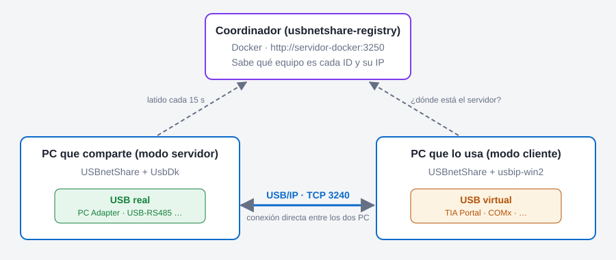
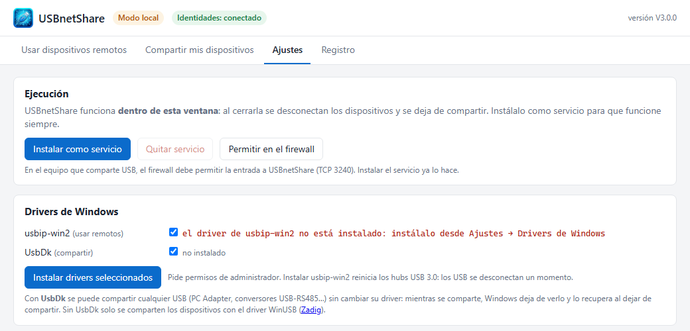
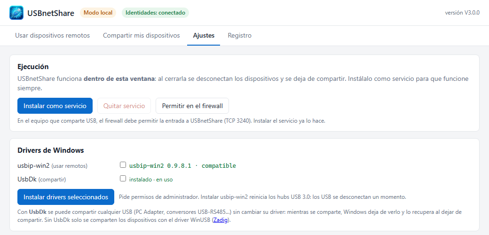
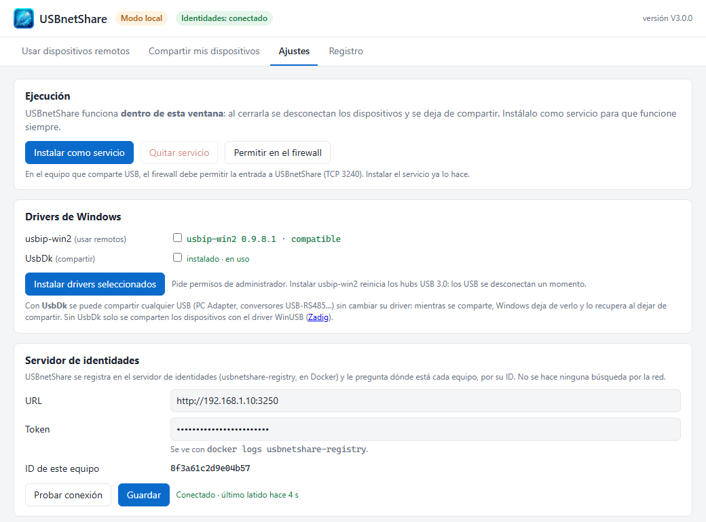
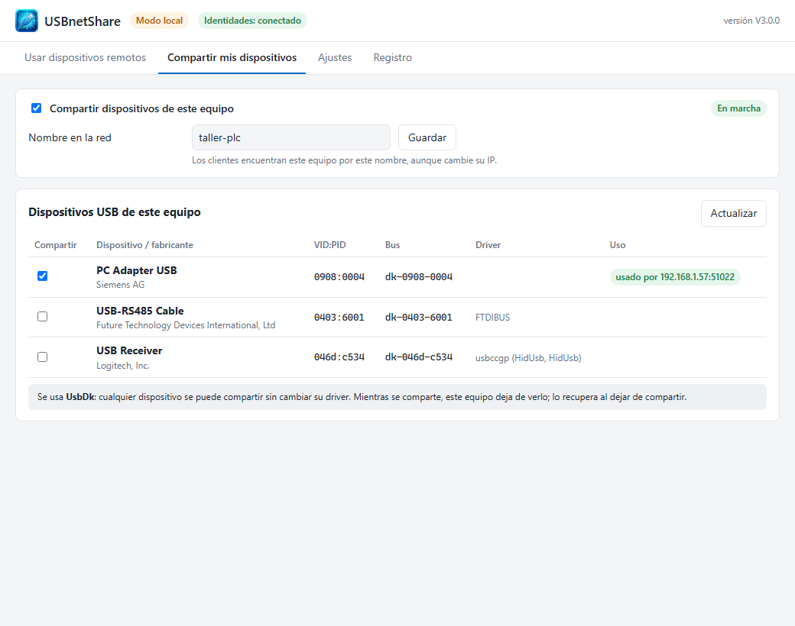
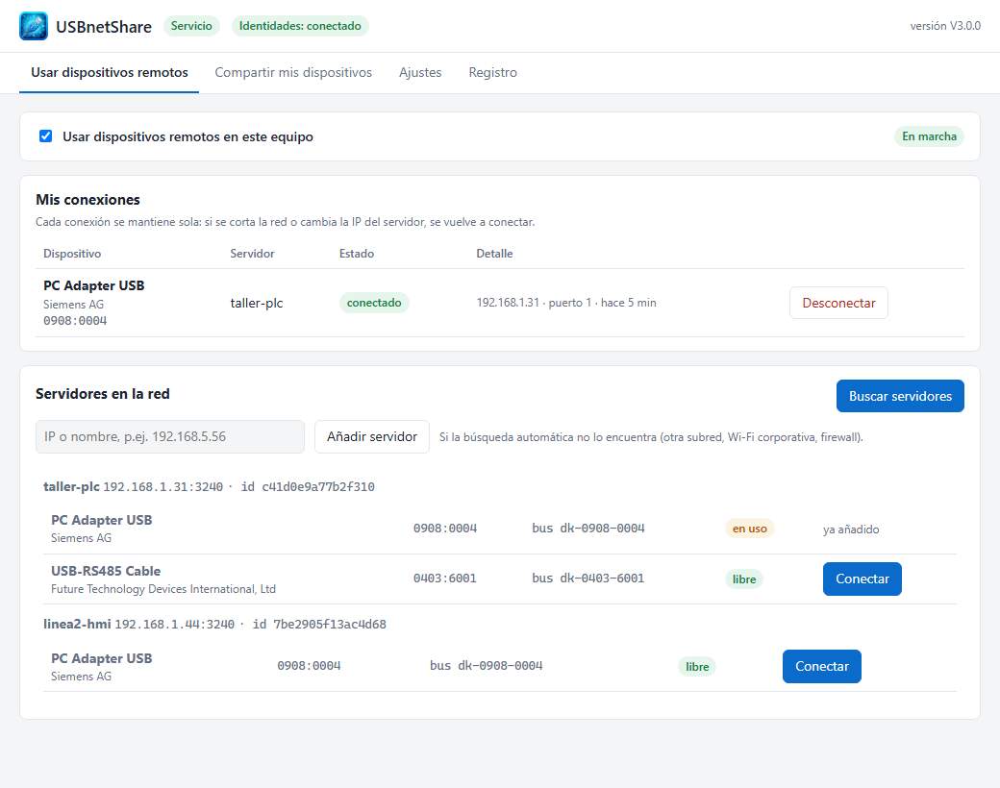

# Tutorial: USBnetShare en Windows (drivers, modo servidor y modo cliente)

USBnetShare permite usar un USB que está enchufado en **otro PC** como si estuviera en el tuyo:
por ejemplo, programar un PLC con TIA Portal a través de un **PC Adapter USB** conectado en
el taller, o leer un **conversor USB‑RS485** desde la oficina.

- **Modo servidor**: el PC donde está **enchufado** el USB lo comparte.
- **Modo cliente**: el PC que lo **usa** ve aparecer el USB como si fuera local.
- **Coordinador**: un servicio en Docker que sabe dónde está cada PC. Lo instala el
  administrador una sola vez (ver [tutorial_coordinador.md](tutorial_coordinador.md)).

Un mismo PC puede ser servidor y cliente a la vez.

---

## 1. Antes de empezar

Necesitas:

- Windows 10 (1903 o posterior) u 11, de 64 bits, con permisos de administrador.
- Los ficheros de la distribución: `USBnetShare.exe`, `libusb-1.0.dll` y la carpeta `licenses`.
- Del administrador del coordinador: la **URL** (p. ej. `http://<servidor-docker>:3250`) y el
  **token** de conexión.
- Los dos PC en una red en la que se vean (el cliente conecta al servidor por TCP 3240).

## 2. Copiar y abrir USBnetShare

1. Crea una carpeta, por ejemplo `C:\USBnetShare`, y copia dentro `USBnetShare.exe`, `libusb-1.0.dll`
   y la carpeta `licenses`. Los tres tienen que estar juntos.
2. Abre `USBnetShare.exe`. La primera vez funciona en **Modo local** (etiqueta naranja arriba): solo
   está activo mientras la ventana está abierta. En el paso 6 lo instalarás como servicio.

> **¿Ya tenías usbnet?** USBnetShare es su nuevo nombre. Al abrirlo por primera vez copia tu
> configuración (coordinador, ID del equipo, USB compartidos y conexiones), así que puedes
> saltarte los pasos 3 y 4. Si tenías usbnet instalado como servicio, en **Ajustes** aparece un
> aviso y el botón **Actualizar servicio**: púlsalo para sustituirlo (paso 6). Después puedes
> borrar el `usbnet.exe` antiguo.

## 3. Instalar los drivers

USBnetShare lleva dentro los dos drivers que necesita. Ve a **Ajustes → Drivers de Windows**:

| Driver | Para qué sirve | Dónde instalarlo |
|---|---|---|
| **usbip-win2** | Crea el USB virtual en el PC que usa el dispositivo | PC en **modo cliente** |
| **UsbDk** | Permite compartir cualquier USB sin cambiar su driver | PC en **modo servidor** |

Si el PC va a hacer las dos cosas, deja marcados los dos.

1. Marca los drivers que necesites (vienen marcados los que faltan).
2. Pulsa **Instalar drivers seleccionados** y acepta el aviso de administrador de Windows.
3. Espera a que aparezca «Drivers instalados». Si dice que hay que reiniciar Windows, reinicia.

> Al instalar usbip-win2 se reinician los hubs USB 3.0: los USB del PC se desconectan
> un momento. Hazlo cuando no estés usando ninguno.

Cuando termina, los dos aparecen en verde:

## 4. Conectar con el coordinador

En la misma pestaña **Ajustes**, tarjeta **Servidor de identidades**:

1. **URL**: la que te ha dado el administrador, p. ej. `http://<servidor-docker>:3250`.
2. **Token**: el token de conexión.
3. Pulsa **Probar conexión** y después **Guardar**.
4. Arriba debe aparecer la etiqueta verde **Identidades: conectado**.

El **ID de este equipo** identifica al PC aunque cambie de IP o de nombre; no hace falta
apuntarlo.

## 5a. Modo servidor: compartir un USB

En el PC donde está enchufado el dispositivo, pestaña **Compartir mis dispositivos**:

1. Marca **Compartir dispositivos de este equipo**.
2. **Nombre en la red**: un nombre fácil de reconocer (p. ej. `taller-plc`) y **Guardar**.
3. En la lista, marca **Compartir** en el USB que quieras ofrecer.

Qué verás:

- En **Uso** aparece «usado por …» cuando un cliente lo está usando.
- La nota inferior indica «Se usa **UsbDk**»: se puede compartir cualquier USB sin cambiar su
  driver.
- **Mientras se comparte, este PC deja de ver el dispositivo** (desaparece del Administrador de
  dispositivos). Lo recupera al quitar la marca de Compartir o al cerrar USBnetShare.
- Si marcas un teclado, ratón o receptor inalámbrico, USBnetShare pide confirmación: este PC se
  quedaría sin él.
- La columna **Bus** muestra `dk-vvvv-pppp` (p. ej. `dk-0908-0004`). Es normal con UsbDk.

## 5b. Modo cliente: usar un USB remoto

En el PC que va a usar el dispositivo, pestaña **Usar dispositivos remotos**:

1. Marca **Usar dispositivos remotos en este equipo**.
2. Pulsa **Buscar servidores**: aparecen los PC que comparten USB, con sus dispositivos.
   - **libre**: se puede conectar.
   - **en uso**: lo está usando otro PC.
3. Pulsa **Conectar** en el dispositivo que quieras.
4. En **Mis conexiones** pasa a **conectado**. Windows lo detecta como si lo hubieras enchufado:
   TIA Portal ve el PC Adapter, un conversor USB‑RS485 aparece como un puerto **COM** nuevo, etc.

Las conexiones se recuerdan: si se corta la red, se reinicia el servidor o se desenchufa y
vuelve a enchufar el USB, **se vuelven a conectar solas**. Para dejar de usarlo, pulsa
**Desconectar**.

Estados de una conexión:

| Estado | Significado |
|---|---|
| **conectado** | Funcionando. |
| conectando / buscando | Localizando el servidor o el dispositivo. |
| esperando dispositivo | El servidor responde pero el USB está desenchufado allí. Se conecta solo al volver. |
| reintentando | Ha fallado; mira el detalle y la pestaña **Registro**. |

> Si el servidor no aparece al buscar (otra subred, Wi‑Fi corporativa), escribe su IP en
> «IP o nombre» y pulsa **Añadir servidor**.

## 6. Dejarlo funcionando siempre (servicio)

En **Ajustes → Ejecución**, pulsa **Instalar como servicio** y acepta el aviso de
administrador. A partir de ahí USBnetShare:

- arranca con Windows, aunque nadie inicie sesión;
- sigue compartiendo o usando los USB aunque cierres la ventana;
- añade la regla del Firewall de Windows para TCP 3240.

La etiqueta de arriba pasa a **Servicio** (verde). Para volver atrás: **Quitar servicio**.

## 7. Problemas frecuentes

| Síntoma | Qué hacer |
|---|---|
| «Identidades: sin conexión» | Revisa URL y token (pídelos al administrador) y que el PC llega al puerto 3250. |
| El servidor no aparece al buscar | Comprueba que en el servidor está marcado «Compartir» y que usa el mismo coordinador. O añádelo por IP. |
| «el servidor ya no tiene ese dispositivo…» | El USB se desenchufó o se reconectó en el servidor. La conexión se reintenta sola. |
| «el driver de usbip-win2 no está instalado» | Paso 3 en el PC cliente. |
| En el servidor el USB aparece en rojo «necesita UsbDk o WinUSB» | Instala UsbDk (paso 3) en el servidor. |
| UsbDk «instalado · no se usa» (naranja) | UsbDk no consigue listar los USB por algún dispositivo concreto. Desenchufa los USB que no compartas y reinicia USBnetShare. Mientras tanto se usa WinUSB. |
| El cliente no conecta y el servidor no muestra «usado por» | Firewall del servidor: **Ajustes → Permitir en el firewall** (o instala el servicio). |

Para más detalle, la pestaña **Registro** muestra lo que va haciendo USBnetShare; cópialo al pedir
ayuda.

> **Seguridad**: USB/IP no cifra la conexión. Úsalo solo dentro de la red de la empresa.
